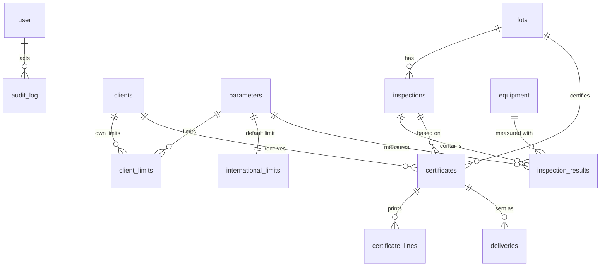

# Domain

## Glossary

Spanish is the word users and the course documents use. English is the name in code.

| Spanish (UI, docs) | English (code) | Meaning |
| --- | --- | --- |
| Cliente | `client` | Company that buys flour and may need a certificate. Key = SAP ByD client key (`sapKey`) |
| Clave SAP / SAP ByD | `sapKey` | Client id in the company's ERP (SAP Business ByDesign). Manual in v1, synced in v2 |
| Equipo de laboratorio | `equipment` | A lab machine, either an alveograph or a farinograph |
| Alveógrafo (Chopin) | `alveograph` | Measures dough tenacity and extensibility by inflating a bubble |
| Farinógrafo (Brabender) | `farinograph` | Measures water absorption and mixing behavior |
| Parámetro / factor | `parameter` | One measured value, for example W or stability |
| Valores de referencia | limits (`internationalLimits`, `clientLimits`) | Lower and upper limit per parameter |
| Valores internacionales | `international_limits` | Default limits from international standards, used for any parameter a client did not define |
| Valores particulares | `client_limits` | A client's own limits, override the international ones per parameter |
| Lote de producción | `lot` | Batch of finished flour, identified by a lot code |
| Inspección / análisis | `inspection` | One analysis of a lot, holding results from both machines |
| Secuencia de inspección | `sequence` | A, B, … Z, AA… per lot, assigned by the system |
| Certificado de calidad | `certificate` | PDF issued for a client order with results and deviations |
| Desviación | `deviation` | Signed distance from the nearest limit when a value is out of range, 0 otherwise |
| Pedido / orden de compra | `purchaseOrder` | Client's order number printed on the certificate |
| Factura | `invoiceNumber` | Invoice number, required before closing the certificate |
| Envío | `delivery` | One email delivery attempt with recipients and result |
| Almacén / Jefe de Almacén | warehouse | Receives the certificate by email and prints it |
| Bitácora | `auditLog` | Append-only log of who did what |
| Baja / inactivación | `retired` / `inactive` | Soft states. Nothing is hard-deleted |
| Usuario de transacción / de consulta | role `transaction` / `query` | The two access levels |
| Add-on de tráfico | (none in v1) | SAP customization where the warehouse flags urgent orders. Possible v2 integration |
| Nitro | (none) | Nitro PDF Pro, the manual tool used today to paste charts into certificates. The new system replaces it |

## Mandatory parameters

Source of truth in code is `src/lib/domain/parameters.ts`. Units are a first guess and still need confirmation (decision Q-11).

| Code | Machine | Label (UI) | Unit |
| --- | --- | --- | --- |
| `ALV_P` | Alveograph | Tenacidad (P) | mm H₂O |
| `ALV_L` | Alveograph | Extensibilidad (L) | mm |
| `ALV_W` | Alveograph | Fuerza panadera (W) | 10⁻⁴ J |
| `ALV_PL` | Alveograph | Relación P/L | ratio |
| `ALV_IE` | Alveograph | Índice de elasticidad (I.E.) | % |
| `FAR_ABS` | Farinograph | Absorción de agua | % |
| `FAR_DEV` | Farinograph | Tiempo de desarrollo | min |
| `FAR_STA` | Farinograph | Estabilidad | min |
| `FAR_SOF` | Farinograph | Grado de ablandamiento | UF (farinograph units) |
| `FAR_ARR` | Farinograph | Tiempo de llegada | min |

## Data model

Defined in `src/lib/db/schema.ts` (Drizzle, Postgres, snake_case columns). It ports `docs/02_modelo_bd.sql` and adds the tables the team document implies but the SQL draft did not have yet.

| Table | Notes |
| --- | --- |
| `user`, `session`, `account`, `verification` | Better Auth. `user.role` is `transaction` or `query`, `user.employee_id` is the employee number |
| `clients` | `sap_key` unique, `status` active or inactive with `status_reason` |
| `equipment` | `id` is the generated 8-char key, `type` alveograph or farinograph, `status` active, inactive or retired |
| `parameters` | The ten codes above, seeded from code |
| `international_limits` | One row per parameter (primary key `parameter_code`). The default range every client falls back to |
| `client_limits` | A client's own ranges, primary key (`client_id`, `parameter_code`), zero to ten rows per client |
| `lots` | Lot code as primary key, product, production and expiry dates |
| `inspections` | Unique (`lot_id`, `sequence`). `locked_at` is set when a certificate uses it. `reinspection_reason` for authorized re-inspections |
| `inspection_results` | One row per parameter, with the machine used |
| `certificates` | Order, invoice, quantities, dates, signature flag, `status` draft, issued or sent, PDF URL |
| `certificate_lines` | Snapshot of value, limits and deviation at issue time, so history never changes |
| `deliveries` | Evidence of each email attempt |
| `audit_log` | Append-only, copies employee id and name |

Differences from `docs/02_modelo_bd.sql` are listed in [decisions.md](decisions.md) (D-06, D-07).
